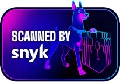

# vd3-ui-core

<a href="https://snyk.io/?utm_source=open-source&utm_medium=pg-ptr&utm_campaign=ref-2501-osp&utm_content=pg-cta"></a>

[](./LICENSE)

Normative web design system specification and W3C DTCG 2025.10 design tokens for the **vd3** line, grounded in the Golden Ratio ($\phi \approx 1.6180339887$), Fibonacci numbers ($F_n$), and Lucas numbers ($L_n$).

Framework-agnostic by contract (PRN-004): consume the DTCG tokens and zero-framework CSS from any stack — vanilla JS, React, Vue, Svelte — with zero runtime dependency. Project codename: **HydroCORE** (*vanduo* means water in Lithuanian).

**Status: 1.0.1-draft.** Published at [core.vanduo.dev](https://core.vanduo.dev/). Agents integrating or auditing the specification should read [AGENTS.md](./AGENTS.md). Release notes are in [CHANGELOG.md](./CHANGELOG.md).

## Repository Roles (`vanduo-oss`)

| Repo | Role |
| --- | --- |
| `vd3-ui-core` (this repo) | Normative specification, W3C DTCG tokens, zero-framework CSS primitives, and verification suites ([core.vanduo.dev](https://core.vanduo.dev/)) |
| [`vd3`](https://github.com/vanduo-oss/vd3) | Vue 3 component library (`@vanduo-oss/vd3`) implementing this specification ([vd3.vanduo.dev](https://vd3.vanduo.dev/)) |
| [`vd3-charts`](https://github.com/vanduo-oss/vd3-charts) | Vue 3 SVG chart library (`@vanduo-oss/vd3-charts`) |
| [`vd3-flowchart`](https://github.com/vanduo-oss/vd3-flowchart) | Vue 3 SVG flowchart editor (`@vanduo-oss/vd3-flowchart`) |

## Conformance

Implementing libraries declare the specification version they conform to in `package.json`:

```json
"implements": "vd3-ui-core@^1.0"
```

CI in each implementing library MUST verify:
1. Generated CSS custom properties match [tokens/vd3.tokens.json](./tokens/vd3.tokens.json).
2. Component anatomy, states, focus geometry, and keyboard behavior match the cited W3C WAI-ARIA APG patterns in [components/](./components/).

## Architecture & Directory Structure

- **[foundations/](./foundations/)** — First principles (`PRN-001`…`PRN-008`), Three-Class Basis Contract (Class A $\phi$-derived, Class B conventional-by-design, Class C registered exceptions `C-01`…`C-04`), proportion, space, line, typography, motion, elevation, glass, color, layout, and focus.
- **[tokens/](./tokens/)** — Audited W3C DTCG 2025.10 token source ([vd3.tokens.json](./tokens/vd3.tokens.json)), dual-prefixed CSS custom properties (`--vd3-*` and `--vd-*` in [tokens.css](./tokens/tokens.css)), JSON Schema ([schema.json](./tokens/schema.json)), and Figma binding manifest ([figma.manifest.json](./tokens/figma.manifest.json)).
- **[components/](./components/)** — Normative specifications (`<slug>/spec.md` + [SPEC.md](./components/SPEC.md)) and zero-framework layered CSS primitives ([index.css](./components/index.css)) for 11 core components (`button`, `input`, `select`, `checkbox`, `radio`, `switch`, `card`, `badge`, `alert`, `tabs`, `dialog`).
- **[conventions/](./conventions/)** — Token naming contract ([naming.md](./conventions/naming.md)) and IBM Carbon cross-system translation matrix ([mappings.md](./conventions/mappings.md)).
- **[site/](./site/)** — Pre-rendered SSG specification bible built with Vue 3, Vite, and `@vanduo-oss/vd3` (`VdNavbar`, `VdThemeSwitcher`, `VdThemeCustomizer`), exposing Schema.org JSON-LD and `data-vd-*` machine-readable metadata for headless AI agents.
- **[scripts/](./scripts/) & [tests/e2e/](./tests/e2e/)** — 7 automated verification suites validating token math, component contracts, prose integrity, TypeScript/JSON schemas, WCAG AA/AAA accessibility, and Tier 1–4 E2E scenarios.

## Figma Design System & MCP Integration

- **Official Figma Kit**: [VD3 Design System — UI Core & Components (v1.0)](https://www.figma.com/design/ae5AMiPoVXuHdaRfawhyjh) (`fileKey: ae5AMiPoVXuHdaRfawhyjh`), seeded with editable Foundation & Component specimen boards (`2:2`, `2:73`, `2:187`, `2:519`).
- **1-Click Token & Component Builder Plugin**: Open [VD3 Design System Builder & Token Sync](https://www.figma.com/design/ae5AMiPoVXuHdaRfawhyjh?try-tool-resource-content-id=473bca03-b7e4-4a6f-9b5c-1a755a58af4b&try-tool-resource-type=gen_tool) (`id: 473bca03-b7e4-4a6f-9b5c-1a755a58af4b`, `version: 6d6824bf91a335c4313fcd249cdcea8d64dfd4d9`) inside Figma to hydrate:
  - `VD3 Color Primitives` (`Fibonacci` & `Open Color` modes across 25 color families + `common/white`, `common/black`, `gray/10` with `WEB` code syntax `var(--vd-*)`).
  - `VD3 Semantic Theme` (`Light` & `Dark` modes aliased to Primitives).
  - `VD3 Scale & Proportions` (`space/fib-1..144`, `radius/fib-2..21`, `radius/full`, `line/hair..thick`, `container/sm..2xl`).
  - `VD3/*` Text & Effect Styles (including `VD3/Focus Ring (Dual)`) plus 11 normative `COMPONENT_SET`s (`Button`, `Input`, `Select`, `Checkbox`, `Radio`, `Switch`, `Badge`, `Alert`, `Card`, `Tabs`, `Dialog`) and a Light vs Dark Showcase frame.
- **MCP & Machine Manifest**: [tokens/figma.manifest.json](./tokens/figma.manifest.json) (live at [core.vanduo.dev/tokens/figma.manifest.json](https://core.vanduo.dev/tokens/figma.manifest.json)) binds Figma file, plugin, collections, styles, and component variant matrices to `vd3-ui-core`.

## Scripts

```bash
pnpm install       # install workspace dependencies
pnpm dev           # synchronize tokens and start Vite dev server
pnpm build         # build site/dist and inject pre-rendered SSG HTML + DTCG tokens
pnpm test          # run all 7 verification suites (tokens, components, m2, typecheck, a11y, e2e)
```

## Security

This repo is monitored with [Snyk](https://snyk.io/?utm_source=open-source&utm_medium=pg-ptr&utm_campaign=ref-2501-osp&utm_content=pg-cta).

## License

[MIT](./LICENSE). "vd3" and the golden-ratio mark are Vanduo's; do not imply IBM or W3C endorsement.
